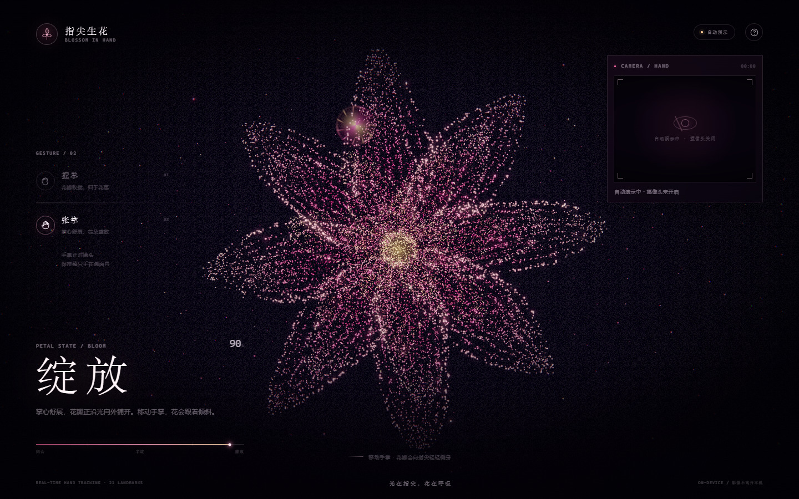
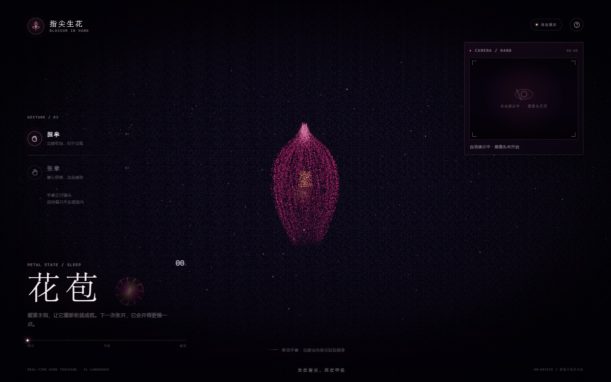

# 指尖生花 · Blossom in Hand

一朵由光和粒子构成的花，长在你的指尖。

摄像头识别 21 个手部关键点：**握拳时收拢成花苞，张开手掌时向指尖盛放**。手掌移动时，花会轻轻侧身；指尖靠近花瓣，会留下局部的暖光与扰动。

> Three.js 实时粒子 + MediaPipe Hands 手势识别 + 手写 GLSL Bloom 后处理  
> 无构建步骤，所有依赖已本地化，直接通过 HTTP 打开即可。



---

## 立即运行

浏览器出于安全限制，不允许从 `file://` 加载 ES Module、WASM 和摄像头。**必须通过本地 HTTP 访问。**

### 方式一：双击启动（Windows）

双击 **`start.bat`**。脚本会自动寻找 `py` / `python` / `node`，启动本地服务并打开：

```text
http://127.0.0.1:8123/
```

### 方式二：Python

```bash
cd "D:\ai协作\好玩的"
python -m http.server 8123 --bind 127.0.0.1
```

### 方式三：Node.js

```bash
cd "D:\ai协作\好玩的"
node server.mjs
# 或指定端口
node server.mjs 8080
```

打开 `http://127.0.0.1:8123/`，点击「授权摄像头 · 开启体验」。

> 第一次加载需要读取约 7.8 MB 的手部模型和 WASM，请等待加载卡片消失。  
> 如果只想看效果，点击「先看自动演示」，或访问 `/?demo=1`。

### 操作

| 操作     | 效果            |
| ------ | ------------- |
| 握拳     | 花瓣收拢，回到花苞     |
| 张开手掌   | 粒子沿花瓣轨迹向外绽放   |
| 移动手掌   | 花朵轻微倾斜、跟随     |
| 指尖靠近花瓣 | 局部粒子被推开，出现暖光  |
| `D`    | 随时进入 / 返回自动演示 |
| `Esc`  | 关闭体验说明        |

建议手掌距离镜头 **40–70 cm**，整只手保持在画面内，并让手背或掌心正对镜头。

---

## 它如何工作

### 1. 手势 → 一个连续的开合值

`js/gesture.js` 只做纯数学计算，不依赖 DOM、WebGL 或 MediaPipe，方便单独测试。

对四根手指分别计算：

- **伸展度**：指尖到手腕的距离 / 手掌尺寸；
- **直线度**：指根到指尖的直线距离 / 四段骨骼总长度；
- **张开度**：食指与小指指尖的横向距离；
- **拇指外展**：拇指尖相对食指、小指根和拇指根的位置。

加权得到 `openness ∈ [0, 1]`。`GestureSmoother` 再做帧率无关的指数阻尼，并用 `0.62 / 0.34` 两个阈值形成迟滞，避免文字状态在临界值附近闪烁。

摄像头画面是镜像预览，但送给模型的坐标保持原始方向；绘制骨架时再镜像，因此手和画面始终一致。

### 2. 一颗双形态的花

`js/flower.js` 为大约 1.8 万个粒子同时保存两套位置：

- `position`：闭合花苞。四层花瓣沿不同半径、不同高度旋转包裹，顶部收尖，形成竖向泪滴；
- `aBloom`：开放花冠。8 / 8 / 7 / 5 片花瓣向外铺开，花瓣有杯状弧度、纵向丝线和奶油色边缘。



顶点着色器用每颗粒子自己的 `aDelay`，在 `uOpen` 驱动下依次混合两套位置：

```glsl
float t = smoothstep(aDelay, aDelay + 0.55, uOpen);
vec3 p = mix(position, aBloom, t);
```

所以绽放不是整体缩放，而是**花瓣从内到外、从根部到尖端依次打开**。粒子还会做轻微的正弦浮动，并在指尖附近被高斯力场推开。

### 3. 不用后处理库的 Bloom

`js/postfx.js` 手写了一条轻量 HDR 管线：

```text
场景 → HalfFloat RT → 亮度提取（半分辨率）
     → 横向高斯 → 纵向高斯 → 二次模糊
     → ACES 色调映射 + 冷暖分离 + 暗角 + 胶片颗粒 + sRGB
```

没有引入 `EffectComposer` 和 `UnrealBloomPass`，减少依赖，也让粒子的粉金色更可控。

### 4. 花瓣的“丝线”采样

完全随机撒点会变成一团粉云。这里把约 86% 的粒子约束在每片花瓣的 9 条纵向丝线上，其余 14% 做体积填充；靠近边缘的粒子更大、更亮，并混入奶油色。远看有清晰的花瓣轮廓，近看仍保留粒子感。

---

## 目录结构

```text
好玩的/
├─ index.html                 页面结构、importmap、入场卡
├─ server.mjs                 零依赖静态服务器（Node）
├─ start.bat                  Windows 一键启动
├─ css/
│  └─ style.css               视觉系统、响应式、动效
├─ js/
│  ├─ main.js                 场景、模式、手势融合、UI
│  ├─ flower.js               粒子花、花苞、花心、指尖光环
│  ├─ gesture.js              21 点手势分析与平滑
│  ├─ hand-tracker.js         MediaPipe 初始化、摄像头、骨架叠加
│  └─ postfx.js               HDR Bloom / 色调映射
├─ models/
│  └─ hand_landmarker.task    MediaPipe 手部模型（约 7.8 MB）
└─ vendor/
   ├─ three/three.module.js   Three.js r169
   └─ mediapipe/              Tasks Vision 0.10.14 + WASM
```

---

## 技术细节

- **Three.js r169**：`Points` + 自定义 `ShaderMaterial`，加法混合，深度写入关闭。
- **MediaPipe Tasks Vision 0.10.14**：`HandLandmarker`，`VIDEO` 模式，单只手，GPU delegate 优先，失败自动回退 CPU。
- **原生 ES Module**：通过 `importmap` 把 `three` 和 `@mediapipe/tasks-vision` 映射到 `vendor/`，不需要打包器。
- **响应式**：桌面相机距离与竖屏分开计算；移动端 390×844 已验证无横向溢出。
- **降级**：模型或摄像头失败时自动进入演示，并保留「重试」入口。
- **性能**：DPR 上限 1.75（移动端 1.6）；bloom 在半分辨率进行；粒子上限约 1.8 万。

### 隐私

- 摄像头流只进入 `<video>` 和本机 MediaPipe 推理；
- 没有上传接口、没有录制、没有分析脚本；
- 页面关闭后浏览器会释放摄像头。

---

## 已验证

- Node `--check`：五个业务模块语法通过；
- 1440×900 桌面：入口页、自动演示、花苞、盛放四种状态截图通过；
- 390×844 竖屏：布局与花朵构图通过；
- MediaPipe 初始化：GPU delegate 成功，`Graph successfully started running.`；
- 假摄像头端到端：`getUserMedia` → 1280×720 视频 → `HandLandmarker` 检测循环 → 寻找手部状态，无控制台错误；
- 摄像头骨架叠加已按 `object-fit: cover` 做镜像与裁切对齐。

真实手掌的握拳 / 张掌识别需要用户在浏览器中授权摄像头后确认。若识别不稳定，优先检查光线、手掌距离和是否整只手都在画面内。

---

## 常见问题

**页面一直停在「正在唤醒摄像头」**  
确认是通过 `http://localhost` 或 `http://127.0.0.1` 访问，而不是双击 `index.html`。首次加载需要读取 WASM 和 7.8 MB 模型。

**浏览器没有弹出摄像头授权**  
检查地址栏的摄像头权限；如果之前拒绝过，点击摄像头面板下方的「重试」，或在站点设置里重新允许。

**有画面但没有骨架**  
把手掌正对镜头，距离 40–70 cm，并保证光线充足。MediaPipe 对逆光、手部过近和严重遮挡比较敏感。

**画面卡顿**  
关闭其他占用摄像头或 GPU 的应用；把浏览器窗口缩小；确认硬件加速已开启。

**端口被占用**

```bash
python -m http.server 8124 --bind 127.0.0.1
# 或
node server.mjs 8124
```

---

## 第三方资源

- [Three.js](https://threejs.org/) r169 — MIT License
- [MediaPipe Tasks Vision](https://ai.google.dev/edge/mediapipe/solutions/vision/hand_landmarker) 0.10.14 — Apache License 2.0
- `hand_landmarker.task` — Google MediaPipe 官方手部关键点模型，本地镜像自 `faunris/ai-hand-tracking`

本项目原创代码可自由用于学习与个人作品；再分发时请保留上述第三方许可证与版权声明。
